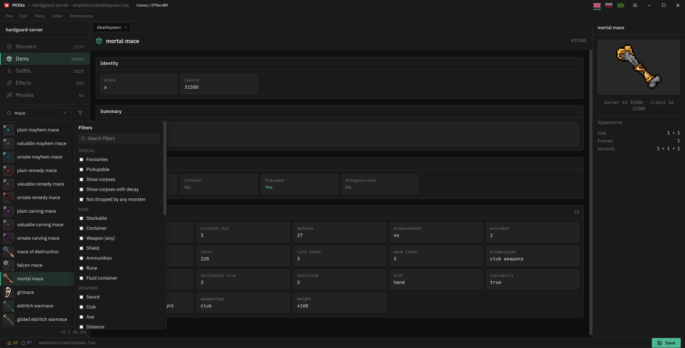

# Items UI — initial prototype

**Status:** substantial initial prototype. This contribution proves the product
shape and the safe picker lifecycle, but it is intentionally open to upstream
review, reshaping or partial rollback. It reuses MONx's existing catalogues,
virtualized rows, sprite protocol and editor layout rather than introducing a
second item engine.

_Real Canary/OTServBR workspace on Linux. This image records the prototype for
discussion; it is not a final visual contract._

## What the prototype proves

- **Items can be a first-class, read-only catalogue.** The sidebar owns the
  searchable/filterable list, the centre column owns selected-item details, and
  the right column follows the selection with `ItemPreviewPanel`.
- **Picking and browsing are different jobs.** Editing a monster's corpse,
  typeex or loot happens in `ItemPickDialog`; the Items rail remains reference
  browsing and does not pretend MONx can write `items.xml` or client files.
- **The existing asset paths are enough.** Server ids address item-database
  icons while client ids address animated appearances. This works without
  inventing an OTB requirement; object pattern X/Y/Z values are variants, not
  outfit directions.

`PreviewPanel` remains monster-specific and the Workspace host selects the typed
item panel while Items is active. The rejected centre-only preview left the last
monster visible on the right; turning one preview into a monster/item union
mixed unrelated data and was not needed for two cases.

## Picker safety contract

An editor picker is a bounded transaction tied to the monster that opened it.

- Opening starts with an empty tray and records the target document/file.
- Closing, cancelling or committing clears the tray. No global command can add
  to a tray while the dialog is absent.
- Navigation closes or invalidates the picker before changing the target.
- **Used by…** is inspection and keeps the picker open; clicking a referenced
  monster is navigation and closes it first.
- Wizard corpse/loot picks are a separate caller: they return ids to the mounted
  wizard and never own or retarget an editor transaction.

These rules matter independently of whichever test monster first exposed the
problem. The invariant is ownership of the pending write, not the fixture.

## Prototype boundary

- The visual density, placement and naming may change to match upstream's
  Windows-first interaction model. The isolated components make that review
  possible without undoing the picker safety rules.
- The full item catalogue and appearance metadata still load when Workspace
  mounts. Lazy loading is a separate performance follow-up, not hidden inside
  this UI PR.
- The work was developed and exercised on Linux/XWayland/WebKitGTK. It adds no
  Linux-specific runtime path and preserves the existing dual `monx://` /
  `http://monx.localhost` URL builders, but the isolated branch still needs a
  Windows user-workflow pass before being called platform-validated.
- Items remains read-only. Writing `items.xml`, `items.otb`, `.dat`, `.spr` or
  modern client bundles is explicitly outside this prototype.

## Changing this area

Read the component comments in `ItemList.tsx`, `ItemDetail.tsx`,
`ItemPreviewPanel.tsx`, `ItemPickPanel.tsx` and `Workspace.tsx`; they are
authoritative for mechanics. Exercise both the rail and the editor/wizard modal
paths, including a workspace without `items.otb`. Run `bun run i18n`, `bun run
commands`, `bun test` and `bun run build` before handing off a change.
